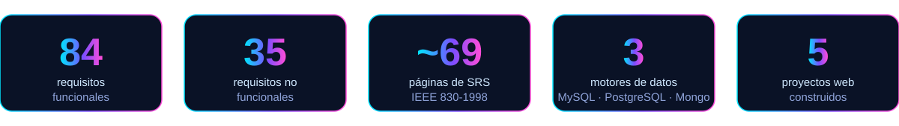

**Aprendiz de Análisis y Desarrollo de Software (SENA) · Medellín, Colombia**

✉️ [tucorreo@ejemplo.com] &nbsp;|&nbsp; 🔗 [LinkedIn](https://linkedin.com/in/tu-usuario) &nbsp;|&nbsp; 💻 [GitHub](https://github.com/cristianrami2202-ux) &nbsp;|&nbsp; 🌐 [Portafolio](https://tu-portafolio.com)

---

## 🚀 Resumen de Impacto

## 💡 Perfil Profesional

Desarrollador en formación que combina **construcción** y **documentación**: no solo programa interfaces y lógica con HTML, Bootstrap 5, JavaScript, Node.js y Python, sino que también levanta requisitos, modela bases de datos y entrega documentación técnica de nivel profesional. Ha participado en el desarrollo completo de un sistema real para una barbería de Medellín (BarberAg), desde la especificación hasta el sitio web. Aprende rápido, corrige con base en retroalimentación y entrega archivos completos y listos para usar.

**Lo que aporto a un equipo:** orden, trazabilidad entre requisitos y código, y disposición constante para aprender nuevas herramientas.

## 🛠️ Stack Tecnológico

| Área | Tecnologías | Dónde lo apliqué |
|---|---|---|
| **Frontend** |    | BarberAg, El Fogón, TECHSTORE, AquaPure, App de Rutinas |
| **Backend** |   | Stack definido para BarberAg; ejercicios de ciclos con Node |
| **Lenguajes** |   | Pilares de la POO, diagramas con Pillow, consultas SQL |
| **Bases de datos** |    | BarberAg, SmartMarket (PL/pgSQL), Sakila, reservas en MongoDB |
| **Documentación** |   | SRS IEEE 830, fichas técnicas, matrices de requisitos, infografías |

**Modelado y análisis:** diagramas entidad-relación y relacional · mapas de navegación · matrices de requisitos · acta de constitución de proyecto

## 🏆 Proyectos Destacados

> 👇 Haz clic en cada proyecto para desplegar los detalles.

<b>💈 BarberAg — Sistema web de gestión para barbería</b> &nbsp;·&nbsp; <i>proyecto de equipo (3 aprendices), Manrique Jardín, Medellín</i>

 

   

* Elaboró una **SRS de ~69 páginas bajo IEEE 830-1998** con 84 requisitos funcionales en 6 módulos (citas, servicios, usuarios, pagos, suscripciones y reseñas) y 35 no funcionales.
* Definió la **ficha técnica del software** (GSE-16/FSE-32) con arquitectura Node.js/Express + MySQL.
* Construyó el **sitio web en HTML/Bootstrap 5** con estética oscura de lujo, planes de suscripción y módulo de reseñas.
* Diseñó los **modelos ER y relacional** y los mapas de navegación del sistema.
* Corrigió observaciones del instructor en el acta de constitución y la matriz de requisitos, mejorando la consistencia del proyecto.

<b>🍽️ El Fogón · 🏍️ TECHSTORE · 💧 AquaPure Colombia · ✅ App de Rutinas</b> &nbsp;·&nbsp; <i>proyectos web</i>

 

 

* **El Fogón:** sitio de cocina colombiana con carruseles, tarjetas de producto y modales de login, registro y detalle.
* **TECHSTORE:** página de e-commerce de motocicletas.
* **AquaPure Colombia S.A.S.:** proyecto integrador con documento corporativo unificado y maqueta de página de ventas con catálogo en COP.
* **App de Rutinas:** rediseñada en dos direcciones (minimalista y editorial) para explorar decisiones de diseño.

<b>🗄️ Bases de datos — SmartMarket · Sakila · Reservas</b> &nbsp;·&nbsp; <i>SQL y NoSQL</i>

 

  

* Procedimientos almacenados en **PL/pgSQL** con IF/CASE, ciclos y cursores.
* Consultas avanzadas: JOINs, GROUP BY, funciones de agregación, subconsultas y UNION.
* Esquema **MongoDB** para reservas de restaurante con colecciones, `$lookup` e índices.

## 🎓 Formación Académica

### **Tecnólogo en Análisis y Desarrollo de Software (ADSO) — Ficha 3425707**
*SENA — Servicio Nacional de Aprendizaje* | *En curso*

### **[Bachillerato o título de secundaria]**
*[Institución]* | *[Año de graduación]*

## 📚 Cursos y Formación Continua

* **JavaScript avanzado (GFPI-F-135)** — *SENA*
* **Pilares de la POO en Python: abstracción, encapsulación, herencia y polimorfismo** — *SENA*
* **PL/pgSQL: estructuras de control y procedimientos almacenados** — *SENA*
* **Negociación de proyectos de software** — *SENA*
* **[Otro curso o certificación]** — *[Institución] ([Año])*

## 🤝 Habilidades Blandas e Idiomas

* **Habilidades blandas:** trabajo en equipo · rigor documental · apertura a la retroalimentación · aprendizaje autónomo · comunicación directa
* **Idiomas:** Español — Nativo · [Inglés — nivel]

## 🎯 Disponibilidad

Disponible para prácticas, pasantías o cargo junior en **desarrollo web, backend o bases de datos**. Presencial en Medellín o remoto.

*"Construyo software que funciona y lo documento para que otros puedan continuarlo."*

